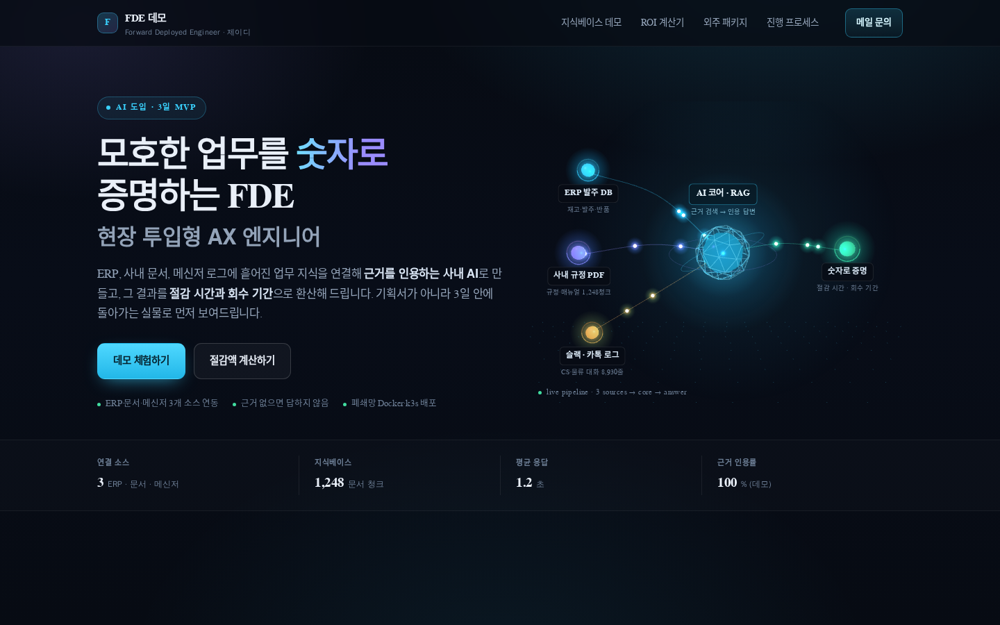
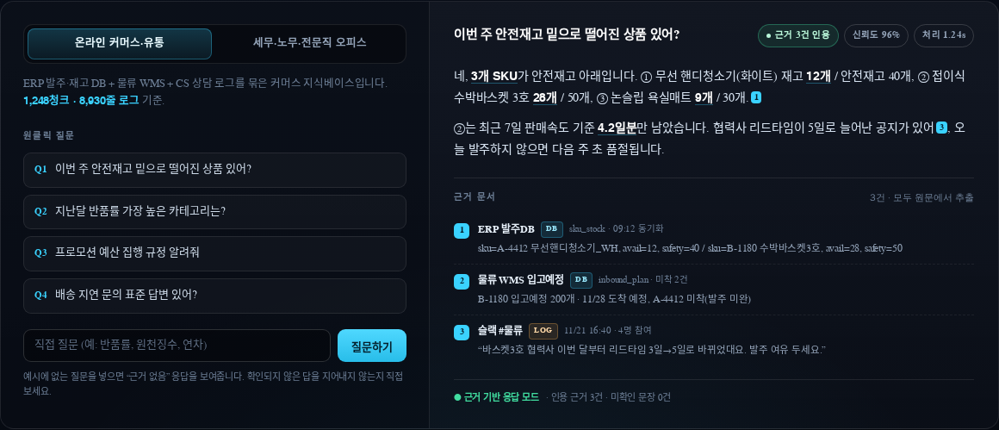
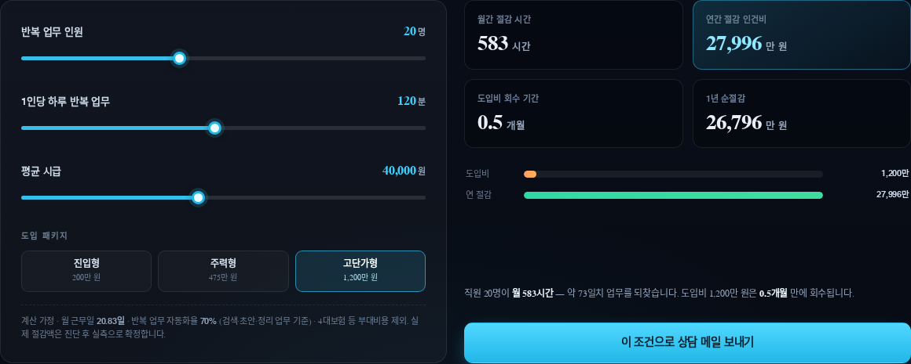
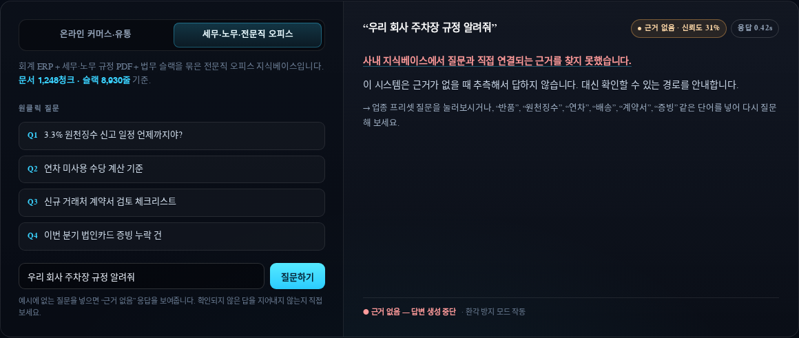
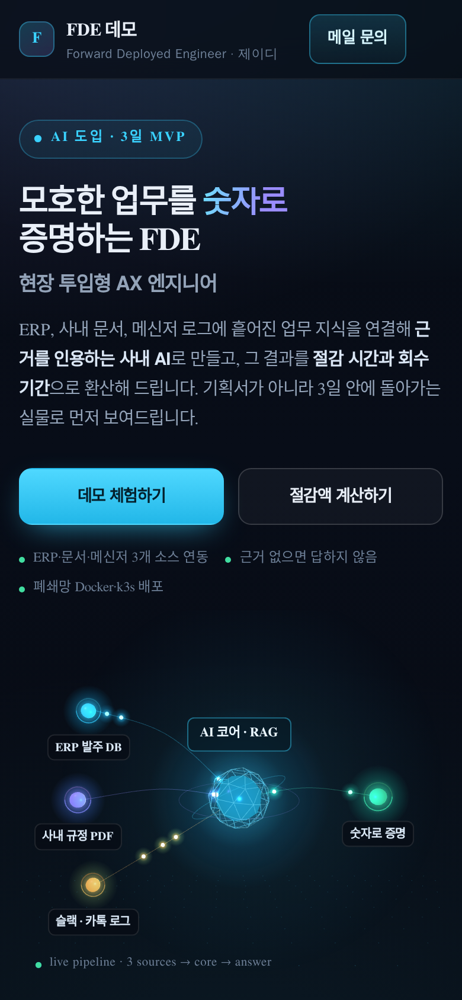

# FDE AX Portfolio — 모호한 업무를 숫자로 증명하는 사내 AI

AI 도입을 검토하는 회사에 **URL 하나로 보여주는** FDE(Forward Deployed Engineer, 현장 투입형 AX 엔지니어) 포트폴리오 데모입니다.
문서 더미가 아니라, 그 자리에서 눌러볼 수 있는 **사내 AI 지식베이스 시뮬레이터**와 **절감액 계산기**가 들어 있습니다.

- **라이브 데모**: https://jackdinealkim.github.io/fde-ax-portfolio/ — 저장소 **Settings → Pages → Deploy from a branch: `main` / `/ (root)`** 를 켜면 위 주소에서 바로 열립니다. (파일 자체는 `index.html` 하나로 완결되어 있어 어떤 정적 호스팅에서도 동작합니다.)
- **문의**: mashiaro@naver.com



---

## 1. 이 데모가 증명하려는 것

| 주장 | 이 페이지에서 확인하는 방법 |
|---|---|
| 사내 데이터 3종(ERP·문서·메신저)을 한 번에 검색한다 | 업종 탭 → 질문 버튼 → 답변마다 `ERP 발주DB` `사내 규정 PDF` `슬랙·카톡 로그` 출처 뱃지 표시 |
| 근거 없는 답을 지어내지 않는다 | 예시에 없는 질문 입력 → **"근거 없음 · 답변 생성 중단"** 응답 확인 |
| 답변 품질을 숫자로 관리한다 | Ragas 4개 지표(§5) · 골든셋 40문항 · CI 게이트 |
| 도입 효과를 돈으로 환산한다 | ROI 계산기 → 월 절감 시간 / 연간 절감 인건비 / **도입비 회수 기간** |
| 폐쇄망에서도 돌아간다 | 폐쇄망 배포 가이드(§6) · 외부 API 호출 0건 구성 |

**중요**: `index.html`의 업종별 질문·답변·출처·Ragas 수치는 **포트폴리오용 시뮬레이션 데이터**입니다. 실제 고객 데이터가 아니며, 실제 프로젝트에서는 고객 데이터로 골든셋을 만들어 같은 방식으로 측정합니다.

## 2. 화면

| 사내 AI 지식베이스 데모 | AX ROI 계산기 |
|---|---|
|  |  |

| 근거 없음(환각 방지) | 모바일 |
|---|---|
|  |  |

## 3. 저장소 구조

```
fde-ax-portfolio/
├── index.html                  # 단일 파일 데모 (three.js 인라인, 네트워크 의존 0)
├── build.py                    # src/index.template.html + three.min.js → index.html
├── src/index.template.html     # 편집용 원본 (마커 /*THREE_INLINE*/)
├── scripts/verify.py           # Playwright 헤드리스 검증 (콘솔 에러·인터랙션·스크린샷)
├── screenshots/                # 검증 스크린샷 + verify-report.json
└── docs/
    ├── DISCOVERY_REPORT_SAMPLE.md   # 고객사 병목 진단 리포트 & 인터뷰 질문 10선
    └── HANDOVER_CHECKLIST.md        # 검수 체크리스트 & 운영 인수인계서
```

### 빌드 / 수정

```bash
python3 build.py            # src/index.template.html → index.html (three.js 인라인)
open index.html             # file:// 로 바로 열림 (CDN 불필요)
```

`index.html`은 **외부 CDN·폰트·이미지 요청이 0건**인 자기완결 파일입니다. GitHub Pages, 사내 웹서버, USB로 옮긴 노트북, 인터넷이 끊긴 발표장에서도 동일하게 동작합니다. WebGL을 쓸 수 없는 환경에서는 히어로 비주얼이 CSS 파이프라인 다이어그램으로 자동 대체됩니다.

### 검증

```bash
pip install playwright && playwright install chromium
python3 scripts/verify.py
```

검사 항목: 콘솔/페이지 에러 0건 · 3D 히어로 초기화 · 업종 탭 전환 · 질문 버튼별 답변·출처 변경 · 자유 검색 매칭 · 근거 없음 경로 · ROI 슬라이더/패키지 전환 · 모바일 가로 오버플로 · 데스크톱(1440×900)/모바일(390×844) 스크린샷.
최근 실행 결과: **30개 체크 통과 / 실패 0 / 콘솔 에러 0** (`screenshots/verify-report.json`).

## 4. 아키텍처 (실제 구축 시)

```
[사내 소스]                         [인덱싱]                        [질의]
ERP PostgreSQL ─┐                                          ┌─ 권한 필터(RBAC)
사내 규정 PDF ──┼─▶ 파서/청킹 ─▶ 임베딩 ─▶ pgvector ─┐        │
메신저 JSON ────┘   (표·각주 보존)   (bge-m3 등)     ├─▶ 하이브리드 검색 ─▶ 리랭커 ─▶ LLM
                                                    │   (벡터 + BM25)      (bge-reranker)
                                      메타데이터 ────┘                       │
                                                                  근거 없음 → 답변 거부
                                                                  근거 있음 → 인용 답변
                                                                           │
                                                          감사 로그 · 응답시간 · 신뢰도
```

- **검색**: 벡터 단독은 숫자·코드·SKU에 약합니다. BM25 + 벡터 하이브리드 후 리랭킹, 표는 별도 청크로 보존.
- **생성**: 답변은 검색된 청크 문장만 재구성. 인용 번호가 없는 문장은 생성 금지(프롬프트 + 후처리 검사 2중).
- **거부**: 최고 유사도·리랭커 점수가 임계값 미만이면 "근거 없음" 응답. 이 데모의 "근거 없음" 화면이 그 동작입니다.
- **평가**: 모든 프롬프트/모델/청킹 변경은 Ragas 골든셋 회귀 테스트를 통과해야 배포(GitHub Actions).
- **스택**: Python · FastAPI · LangGraph · PostgreSQL/pgvector · Ragas · Ollama(폐쇄망) · Docker · k3s · Grafana/Loki.

## 5. Ragas 평가 메트릭 (예시)

골든셋 40문항(업종별 20문항: 정답 가능 15 + 근거 없음 5) 기준 예시값입니다.

| 메트릭 | 측정 대상 | 예시 | 배포 게이트 |
|---|---|---|---|
| **Faithfulness** | 답변 문장이 검색 근거로 뒷받침되는 비율 | 0.96 | **≥ 0.90 (미달 시 배포 차단)** |
| Answer relevancy | 질문과 답변의 관련성 | 0.92 | ≥ 0.85 |
| Context precision | 검색 상위 청크 중 실제로 쓰인 비율 | 0.89 | ≥ 0.80 |
| Context recall | 정답 근거가 검색됐는지 | 0.87 | ≥ 0.80 |
| 거부 정확도 | 근거 없는 질문에 답하지 않은 비율 | 5/5 | **= 100%** |

```python
# scripts/eval_rag.py (개념 예시)
from ragas import evaluate
from ragas.metrics import faithfulness, answer_relevancy, context_precision, context_recall

result = evaluate(dataset=golden_set, metrics=[
    faithfulness, answer_relevancy, context_precision, context_recall])
assert result["faithfulness"] >= 0.90, "faithfulness gate failed"
```

## 6. 폐쇄망(Docker · k3s + Ollama) 배포 가이드 요약

인터넷이 끊긴 망에서 돌아가야 진짜 사내 AI입니다. 반입(搬入) 절차는 항상 같은 4단계입니다.

**① 이미지·모델 번들 만들기 (인터넷 되는 PC)**
```bash
docker build -t rag-api:1.0.0 .
docker save rag-api:1.0.0 postgres:16 pgvector/pgvector:pg16 -o bundle/images.tar
ollama pull llama3.1:8b-instruct-q4_K_M      # 또는 EXAONE 3.5 8B
tar -czf bundle/models.tgz ~/.ollama/models
sha256sum bundle/* > bundle/SHA256SUMS       # 반입 후 무결성 검증용
```

**② 반입 후 로드 (폐쇄망)**
```bash
sha256sum -c bundle/SHA256SUMS
docker load -i bundle/images.tar
tar -xzf bundle/models.tgz -C /opt/ollama
```

**③ k3s 오프라인 설치 + 배포**
```bash
# k3s air-gap: k3s 바이너리 + air-gap images를 /var/lib/rancher/k3s/agent/images/에 넣고 설치
sudo INSTALL_K3S_SKIP_DOWNLOAD=true ./install.sh
kubectl apply -f k8s/namespace.yaml -f k8s/postgres.yaml -f k8s/ollama.yaml -f k8s/api.yaml -f k8s/ui.yaml
kubectl rollout status deploy/rag-api -n rag
```

**④ 검증 (인수 조건)**
```bash
kubectl run netcheck --rm -it --image=busybox -n rag --restart=Never -- \
  sh -c 'wget -qO- --timeout=3 https://example.com || echo "외부 차단 OK"'
curl -s http://rag-api.rag.svc/healthz        # {"status":"ok","llm":"ollama","external_calls":0}
```

| 항목 | 기준 |
|---|---|
| 외부 API 호출 | 0건 (egress 정책으로 차단, 위반 시 알람) |
| 콜드 스타트 | ≤ 90초 (모델 사전 로드 워커) |
| 응답 지연 (p95) | ≤ 8초 (8B q4, CPU 8코어 기준) |
| 백업 | pgvector 스냅샷 일 1회 / 30일 보관, 복구 리허설 분기 1회 |
| 인수인계 | `docs/HANDOVER_CHECKLIST.md` 체크 후 담당자 단독 운영 확인 |

트러블슈팅 일지(예: `ImagePullBackOff` → 이미지 태그 불일치, `ollama` OOM → `--max-loaded-models 1` 제한, 한글 PDF 깨짐 → 폰트·CID 매핑)는 프로젝트별로 저장소에 남깁니다.

## 7. 외주 패키지 · 진행 프로세스

| 패키지 | 가격 | 기간 | 범위 |
|---|---|---|---|
| 진입형 — 사내 AI 지식베이스 | 150~250만 원 | 1주 | 문서 300청크 RAG · 출처 인용 · 20문항 정확도 리포트 |
| **주력형 — 반복 업무 자동화** | **350~600만 원** | **2~3주** | ERP·메신저·문서 3소스 · 에이전트 2~3개 · Ragas CI · 인수인계 |
| 고단가형 — 폐쇄망 보안 구축 | 800만 원~ | 4주+ | Docker·k3s 폐쇄망 · 로컬 LLM · HA·백업·런북 |

**진행 4단계**: ① 업무 진단(Discovery, 1~2일) → ② **3일 MVP 검증**(실데이터 일부로 동작하는 데모) → ③ 구축·배포(클라우드/폐쇄망) → ④ 검수·인수인계(체크리스트 + 담당자 교육).
부가세 별도 · 서버·API 비용 실비 정산 · 범위가 명확하면 3일 내 견적 확정.

## 8. 다음 단계 (이 데모를 실제 제품으로)

1. `FastAPI + LangGraph` 백엔드와 가상 ERP(PostgreSQL) 시드 데이터 → 프론트 JSON API 교체
2. 골든셋 40문항 + `ragas` 채점 + GitHub Actions 워크플로
3. `docker compose`로 로컬 실행 → k3s 매니페스트 → 폐쇄망 번들 스크립트
4. 인수인계 문서 템플릿(`docs/`)을 실제 고객사 값으로 채우기

## 9. 라이선스 · 고지

- 데모 코드: 포트폴리오 열람 목적. 상업적 재배포 전 문의.
- three.js r155 (MIT) — `index.html`에 인라인 포함.
- 화면의 회사명·수치·문서 인용은 모두 예시이며 실제 기업 정보가 아닙니다.
